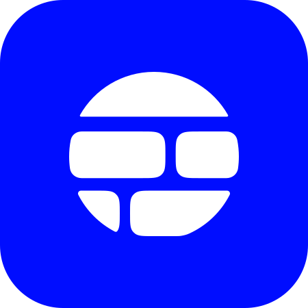

>[!IMPORTANT] 
> Our fork improves and evolves the Shape codebase under the Business Source License 1.1 (BSL 1.1) as published by the upstream project. We respect the upstream copyright and licensing terms, and we are not relicensing the original code. The upstream BSL permits many forms of use, contribution, and self‑hosting today but explicitly restricts offering the software as a standalone, paid competing IDE until the Change Date (2030‑06‑22), after which the code transitions to Apache‑2.0. Because those restrictions create practical barriers for adoption, contribution, and integration in some settings, this fork focuses on improving usability, security, and interoperability within the bounds of the license. This statement is informational and not legal advice, if you plan to redistribute, sell, or integrate this software commercially, please review the LICENSE and consult legal counsel.


# BetterShape



A desktop agent for all your coding needs, plus so much more.

[Website](IN PROGRESS) · [Docs](IN PROGRESS) · [Download](IN PROGRESS) · [Discord](IN PROGRESS)


## Models

Suport for many models.


[Models](IN PROGRESS).

## Plugins

Connect over 20+ plugins the agent can use.


[Plugins](IN PROGRESS)

## Install

Windows 10 or 11, 64-bit. [Installer](https://useshape.org/download). Older builds: [Releases](https://github.com/Owie6789/BetterShape/releases).

Stable is the tested channel. Nightly ships latest and can break.

## Build from source

Node.js 18+, Rust, and [Tauri 2](https://v2.tauri.app/start/prerequisites/).

```bash
npm install
npm run tauri:dev
```

[CONTRIBUTING.md](./CONTRIBUTING.md) and [local development](/docs/developing/local-development).

```bash
npm run test          # Vitest
npm run test:rust     # Cargo
npm run test:all      # Both
```

TypeScript, React, Next.js App Router, Tauri 2, Rust.

## License

[Business Source License 1.1](./LICENSE). Code you send is under the same license.


